  

I'm a master's student at Shanghai University of Engineering Science. My research focuses on software-defined networking, programmable data planes, and in-band network telemetry.

I also build networking tools and developer utilities in Go and Python.

[Website](https://zhh2001.github.io/) · [CV](https://zhh2001.github.io/resume) · [Google Scholar](https://scholar.google.com/citations?user=nCPBFuMAAAAJ) · [Email](mailto:1652709417@qq.com)

## Selected Projects

- **[p4runtime-go-controller](https://github.com/zhh2001/p4runtime-go-controller)**: A Go SDK and `p4ctl` CLI for building P4Runtime controllers. [Docs](https://zhh2001.github.io/p4runtime-go-controller/)
- **[p4net](https://github.com/zhh2001/p4net)**: A Python framework for P4 network emulation with BMv2, P4Runtime, declarative topologies, and an interactive CLI. [Docs](https://zhh2001.github.io/p4net/)
- **[rote](https://github.com/zhh2001/rote)**: A job scheduler written in Go, with persistent run history, captured output, and a terminal dashboard.
- **[p4-protocol-headers](https://github.com/zhh2001/p4-protocol-headers)**: Reusable P4 header definitions for common network protocols.

## Core Technologies

- **Languages:** Go, Python, P4
- **Networking & systems:** BMv2, Mininet, P4Runtime, Linux, Docker
- **Backend:** Gin, gRPC, MySQL, Redis, SQLite

## GitHub Activity

  <a href="https://github.com/zhh2001">
    <picture>
      <source media="(prefers-color-scheme: dark)" srcset="./profile/stats-dark.svg" />
      
    </picture>
  </a>
  <a href="https://github.com/zhh2001">
    <picture>
      <source media="(prefers-color-scheme: dark)" srcset="./profile/top-langs-dark.svg" />
      
    </picture>
  </a>

  <picture>
    <source media="(prefers-color-scheme: dark)" srcset="./profile/snake-dark.svg" />
    
  </picture>

