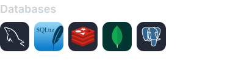
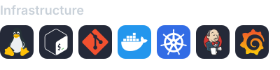

  <picture>
    <source media="(max-width: 600px)" srcset="./profile/header-mobile.svg" />
    
  </picture>

  <a href="https://zhh2001.github.io/">Website</a> ·
  <a href="https://scholar.google.com/citations?user=nCPBFuMAAAAJ">Google Scholar</a> ·
  <a href="https://zhh2001.github.io/resume">About</a> ·
  <a href="mailto:1652709417@qq.com">Email</a>

## `01` / Tech stack

P4Runtime | BMv2 | Mininet

  
  
  
  
  
  

## `02` / GitHub activity

  <a href="https://github.com/zhh2001?tab=repositories">
    <picture>
      <source media="(prefers-color-scheme: dark)" srcset="./profile/stats-dark.svg" />
      
    </picture>
  </a>
  <a href="https://github.com/zhh2001?tab=repositories">
    <picture>
      <source media="(prefers-color-scheme: dark)" srcset="./profile/top-langs-dark.svg" />
      
    </picture>
  </a>

  <picture>
    <source media="(prefers-color-scheme: dark)" srcset="./profile/snake-dark.svg" />
    
  </picture>

