<p align="center">
  <picture>
    <source media="(max-width: 600px)" srcset="./profile/header-mobile.svg" />
    
  </picture>
</p>

<p align="center">
  <a href="https://zhh2001.github.io/"><kbd>~/notes</kbd></a>&nbsp;
  <a href="https://scholar.google.com/citations?user=nCPBFuMAAAAJ"><kbd>~/research</kbd></a>&nbsp;
  <a href="https://zhh2001.github.io/resume"><kbd>~/about</kbd></a>&nbsp;
  <a href="mailto:1652709417@qq.com"><kbd>@email</kbd></a>
</p>

I work on programmable networks and in-band telemetry, and build tools in Go and Python.

## `01` / Programmable networks

- **[p4net](https://github.com/zhh2001/p4net)**: Build P4 network experiments with BMv2, declarative topologies, and an interactive Python CLI. [Docs](https://zhh2001.github.io/p4net/)
- **[p4-protocol-headers](https://github.com/zhh2001/p4-protocol-headers)**: Reusable P4 header definitions for common network protocols.
- **[p4runtime-go-controller](https://github.com/zhh2001/p4runtime-go-controller)**: A Go SDK and `p4ctl` CLI for building P4Runtime controllers. [Docs](https://zhh2001.github.io/p4runtime-go-controller/)

## `02` / Developer tools

- **[rote](https://github.com/zhh2001/rote)**: A job scheduler written in Go, with persistent run history, captured output, and a terminal dashboard.

<details>
<summary><code>stack.yml</code> · Languages &amp; tools</summary>

```yaml
languages: [Go, Python, P4]
network: [P4Runtime, BMv2, Mininet]
platform: [Linux, Docker]
backend: [Gin, gRPC]
storage: [MySQL, Redis, SQLite]
```

</details>

<details>
<summary><code>activity.log</code> · GitHub statistics</summary>

<div align="center">
  <a href="https://github.com/zhh2001">
    <picture>
      <source media="(prefers-color-scheme: dark)" srcset="./profile/stats-dark.svg" />
      
    </picture>
  </a>
  <a href="https://github.com/zhh2001">
    <picture>
      <source media="(prefers-color-scheme: dark)" srcset="./profile/top-langs-dark.svg" />
      
    </picture>
  </a>
</div>

</details>

<p align="center">
  <picture>
    <source media="(prefers-color-scheme: dark)" srcset="./profile/snake-dark.svg" />
    
  </picture>
</p>
